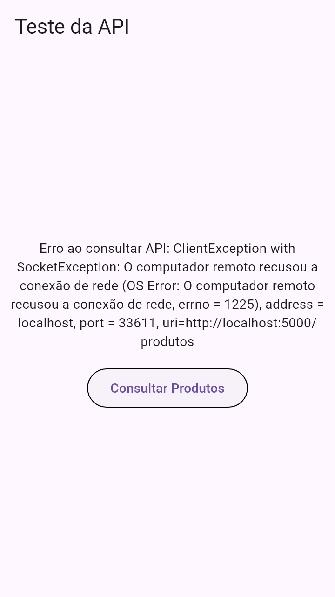
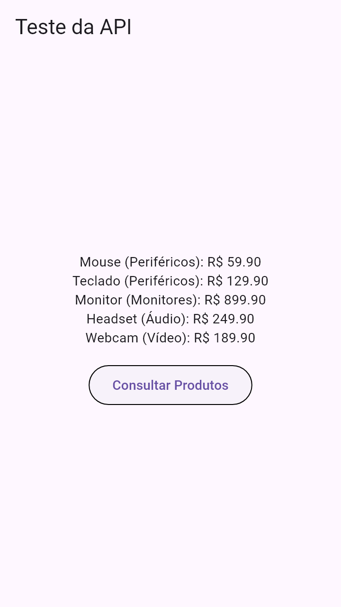

# Atividade Prática 02 — Respostas

## Caminho dos dados (servidor → app)

1. `api.py` guarda a lista `produtos` e a rota `GET /produtos` devolve ela com `jsonify` (texto JSON + status 200).
2. No app, `ProdutoRepository.listarProdutos()` faz o `http.get` em `http://10.0.2.2:5000/produtos`.
3. O repository confere o `statusCode`, converte os bytes da resposta em texto (`utf8.decode`) e o texto em lista de mapas (`jsonDecode`).
4. Cada mapa vira um objeto `Produto` pelo `Produto.fromJson`, e o repository devolve uma `List<Produto>`.
5. A tela recebe a lista, monta o texto e chama `setState`, que redesenha o `Text` com os produtos.

## Questões do Model

**1. Atributos e tipos**
`id` → `int`, `nome` → `String`, `preco` → `double`, `categoria` → `String` (este último veio do Desafio B). Todos são `final`, então não mudam depois que o objeto é criado.

**2. Finalidade do `required`**
Parâmetros nomeados (entre `{}`) são opcionais por padrão. O `required` obriga quem cria o `Produto` a passar aquele valor, e o compilador acusa erro se faltar. Junto com os tipos não-nuláveis, isso garante que nunca existe um produto "pela metade".

**3. Função do `Produto.fromJson()`**
É um construtor `factory` que recebe o `Map<String, dynamic>` vindo do JSON, pega cada chave (`'id'`, `'nome'`, `'preco'`, `'categoria'`), converte para o tipo certo e devolve um `Produto` pronto. Assim a conversão JSON → objeto fica num lugar só, dentro da própria classe.

**4. Por que `preco` é `double`**
Porque preço tem casas decimais (59.90). E como o JSON pode mandar um preço inteiro (ex.: `100`), o código lê como `num` e chama `.toDouble()`, evitando erro de tipo.
Obs.: `double` tem imprecisão de ponto flutuante. Para somar valores em sistema real, o mais seguro é guardar em centavos (`int`).

## Questões do Repository

**5. Instrução que envia a requisição**
```dart
final resposta = await http
    .get(Uri.parse('$baseUrl/produtos'))
    .timeout(const Duration(seconds: 5));
```

**6. Papel do `async` e `await`**
A requisição demora, então ela retorna um `Future`. O `async` marca que o método é assíncrono (e faz ele retornar `Future<List<Produto>>`). O `await` pausa só aquele método até a resposta chegar, sem travar a interface, que continua respondendo enquanto isso.

**7. Código HTTP de sucesso**
`200` (OK). Qualquer outro código cai no `throw Exception('Erro HTTP: ...')`.

**8. Função do `jsonDecode()`**
Converte o texto JSON recebido em estruturas do Dart. Aqui o resultado é uma `List<dynamic>` em que cada item é um `Map<String, dynamic>`.

**9. Como a lista de `Produto` é produzida**
`dados.map((item) => Produto.fromJson(item))` passa cada mapa pelo `fromJson`, gerando um `Iterable<Produto>`. O `.toList()` transforma isso numa `List<Produto>` de verdade, que é o que o método retorna.

## Etapa 6 — Teste de falha

**Mensagem observada com o servidor desligado** (app rodando no Windows, por isso `localhost` em vez de `10.0.2.2`):
> `Erro ao consultar API: ClientException with SocketException: O computador remoto recusou a conexão de rede (OS Error: O computador remoto recusou a conexão de rede, errno = 1225), address = localhost, port = 33229, uri=http://localhost:5000/produtos`



Ao reiniciar a API e consultar de novo, a lista voltou a aparecer normalmente.

**Qual estrutura identifica e trata a falha?**
- **Identifica:** no `ProdutoRepository`. Se o servidor responde com código diferente de 200, o `if (resposta.statusCode != 200)` lança uma `Exception`. Se o servidor está desligado, o próprio `http.get` lança `ClientException` (conexão recusada), e se demorar mais de 5 s o `.timeout` lança `TimeoutException`.
- **Trata:** o bloco `try/catch` em `consultarProdutos()` na tela. Qualquer exceção cai no `catch (erro)`, que mostra `'Erro ao consultar API: $erro'` em vez de o app quebrar. O `if (mounted)` evita chamar `setState` se a tela já foi fechada.

No teste com o servidor desligado quem dispara é a conexão recusada, não o `statusCode`, porque nem chega a existir resposta HTTP.

## Evidências de execução

**Retorno JSON da API** (`curl http://localhost:5000/produtos`):
```json
[
  {"categoria": "Periféricos", "id": 1, "nome": "Mouse", "preco": 59.9},
  {"categoria": "Periféricos", "id": 2, "nome": "Teclado", "preco": 129.9},
  {"categoria": "Monitores", "id": 3, "nome": "Monitor", "preco": 899.9},
  {"categoria": "Áudio", "id": 4, "nome": "Headset", "preco": 249.9},
  {"categoria": "Vídeo", "id": 5, "nome": "Webcam", "preco": 189.9}
]
```

Resposta HTTP completa (status `200 OK`, `Content-Type: application/json`): [evidencias/api_resposta_http.txt](evidencias/api_resposta_http.txt)

**Consulta bem-sucedida no app** (texto exibido após tocar em *Consultar Produtos*):
```
Mouse (Periféricos): R$ 59.90
Teclado (Periféricos): R$ 129.90
Monitor (Monitores): R$ 899.90
Headset (Áudio): R$ 249.90
Webcam (Vídeo): R$ 189.90
```



**Mensagem de erro com o servidor desligado:** ver print e texto na seção *Etapa 6* acima.

Saída dos testes: [evidencias/teste_sucesso.txt](evidencias/teste_sucesso.txt) e [evidencias/teste_falha.txt](evidencias/teste_falha.txt).

As duas consultas (sucesso e falha) podem ser reproduzidas com o teste `aula_bloc/test/api_test.dart`, que toca no botão da tela e confere o texto:
- API ligada: `flutter test test/api_test.dart`
- API desligada: `flutter test test/api_test.dart --dart-define=API_DESLIGADA=true`

Observação: o `main.dart` usa `http://10.0.2.2:5000` no emulador Android e `http://localhost:5000` nas outras plataformas (Windows/web).

## Desafios

**A. Ampliar os produtos**
Adicionei Headset e Webcam no `api.py`. Depois de reiniciar o servidor, o app mostrou os 5 itens sem mexer no Model nem no Repository, porque o repository converte a lista inteira com `map`, independente do tamanho.

**B. Adicionar categoria**
- `api.py`: campo `"categoria"` em todos os produtos.
- `produto.dart`: atributo `final String categoria`, `required` no construtor e leitura no `fromJson`.
- `main.dart`: cada linha agora mostra `Nome (Categoria): R$ preço`.

A consulta continuou funcionando igual.

**C. Usar a API da equipe**
Endpoint escolhido (exemplo — trocar pelo da API da equipe): `GET /clientes`, que retorna
```json
[{"id": 1, "nome": "Ana", "email": "ana@email.com", "ativo": true}]
```

Adaptações:
- **Model:** criar uma classe com os campos que o endpoint retorna (mesmos nomes de chave do JSON) e um `fromJson` convertendo cada tipo, igual ao `Produto`. Campos que podem vir `null` precisam de tipo nulável (`String?`).
- **Repository:** trocar o `baseUrl` pelo endereço da API da equipe e a rota `/produtos` pela rota escolhida. Se a API devolver um objeto em vez de lista (ex.: `{"dados": [...]}`), ler a lista de dentro dessa chave antes do `map`. Se exigir login, enviar o token no `headers` do `http.get`.
- **Tela:** ajustar o texto montado no `map` para exibir os campos da nova classe.

Exemplo aplicado ao `GET /clientes`:
```dart
// cliente.dart
class Cliente {
  final int id;
  final String nome;
  final String? email; // pode vir null
  final bool ativo;

  const Cliente({required this.id, required this.nome, this.email, required this.ativo});

  factory Cliente.fromJson(Map<String, dynamic> json) => Cliente(
        id: (json['id'] as num).toInt(),
        nome: json['nome'] as String,
        email: json['email'] as String?,
        ativo: json['ativo'] as bool,
      );
}

// cliente_repository.dart -> ClienteRepository('http://<ip-da-api-da-equipe>:<porta>')
final resposta = await http.get(Uri.parse('$baseUrl/clientes'));

// tela
'${c.nome} - ${c.email ?? 'sem e-mail'} (${c.ativo ? 'ativo' : 'inativo'})'
```
